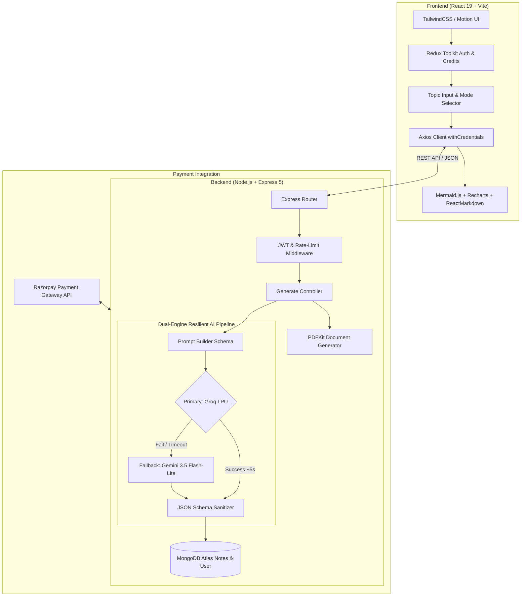

# 🎓 EduNote — AI-Powered Exam Preparation & Intelligent Note Generation Platform

<div align="center">

[](https://edu-note-sigma.vercel.app)
[](https://edunote-otd4.onrender.com)
[](https://react.dev/)
[](https://nodejs.org/)
[](https://www.mongodb.com/)
[](https://groq.com/)
[](LICENSE)

**An enterprise-grade EdTech SaaS application that transforms syllabus topics into syllabus-aligned, exam-oriented study material with interactive visual flowcharts, statistical charts, question banks, and instant PDF exports.**

[Explore Live App](https://edu-note-sigma.vercel.app) · [Report Bug](https://github.com/Manish529-UI/EduNote/issues) · [Request Feature](https://github.com/Manish529-UI/EduNote/issues)

</div>

---

## 📌 Executive Summary

Modern students spend hours sifting through unorganized textbooks, disjointed web searches, and generic AI answers that fail to match exam mark schemes. **EduNote** solves this through a tailored AI pipeline that structures study material according to board/university criteria (CBSE, JEE, NEET, University syllabi).

Rather than generating unstructured walls of text, EduNote dynamically produces:
1. **Priority-Ranked Subtopics** (`⭐`, `⭐⭐`, `⭐⭐⭐`) according to historical exam frequency.
2. **Structured Notes** with explicit definitions, key explanations, and formula derivations.
3. **Interactive Visualizations** combining **Mermaid.js Flowcharts** and **Recharts Data Analytics**.
4. **Curated Exam Question Sets** (Short-answer, Long-answer, and Diagram-based questions).
5. **5-Minute Quick Revision Mode** designed for last-minute cramming and quick recall.
6. **Instant Server-Side PDF Compilation** for offline access and printing.

---

## 🚀 Key Highlights & Architectural Strengths

### ⚡ 1. Ultra-Low Latency Resilient AI Engine (5–7s Generation)
- **High-Speed Primary Engine**: Powered by **Groq LPU** (`openai/gpt-oss-120b`) delivering responses in **under 7 seconds** with native JSON enforcement.
- **Multi-Tier Fault Tolerance**: In the event of network disruption or rate-limits, the system seamlessly cascades down to **Google Gemini 3.5 Flash-Lite** with zero user downtime or system crash.
- **Zero-Hallucination Strict JSON Schema**: Output passes through strict schema validation, ensuring consistent structural integrity across charts, diagrams, and notes.

### 📊 2. Multi-Modal Visual Learning
- **Dynamic Mermaid Flowcharts**: Renders real-time procedural and architectural flowcharts (`graph TD`) directly inside client SVG containers.
- **Statistical Exam Weightage Charts**: Interactive bar, pie, and line charts via **Recharts** showcasing marks weightage and conceptual topic distribution.

### 💳 3. Full-Stack Monetization & Credits Engine
- **Micro-Credits Economy**: Every account starts with free credits; notes generation automatically tracks and decrements balance transactionally.
- **Razorpay Payment Gateway**: End-to-end webhook-ready payment checkout to purchase credit refill packages securely.

### 📄 4. Professional Vector PDF Generation
- High-performance server-side document rendering using **PDFKit**.
- Formats markdown notes, question banks, and topic metadata into print-ready study guides with branded headers and footers.

### 🔒 5. Production-Ready Security & Authentication
- Secure **JWT Authentication** stored in HTTP-Only, SameSite cookies.
- Password hashing with **Bcrypt.js** (salt rounds: 10).
- Express rate-limiting & Helmet-ready CORS policy mapped to production domain origins.

---

## 🏗️ System Architecture



---

## 💻 Tech Stack

### Frontend
- **Framework**: [React 19](https://react.dev/) with [Vite 7](https://vitejs.dev/)
- **Styling**: [TailwindCSS 4](https://tailwindcss.com/)
- **Animation & Transitions**: [Motion (Framer Motion)](https://motion.dev/)
- **State Management**: [Redux Toolkit](https://redux-toolkit.js.org/)
- **Visuals & Charts**: [Mermaid.js](https://mermaid.js.org/) & [Recharts](https://recharts.org/)
- **Markdown Processing**: [React Markdown](https://github.com/remarkjs/react-markdown)
- **Icons**: [React Icons](https://react-icons.github.io/react-icons/)

### Backend
- **Runtime & Framework**: [Node.js](https://nodejs.org/) & [Express 5](https://expressjs.com/)
- **Database**: [MongoDB Atlas](https://www.mongodb.com/) via [Mongoose 9](https://mongoosejs.com/)
- **AI Models**: Groq Cloud SDK (`openai/gpt-oss-120b`) & Google Generative AI (`gemini-3.5-flash-lite`)
- **PDF Compilation**: [PDFKit](https://pdfkit.org/)
- **Payments**: [Razorpay Node SDK](https://razorpay.com/)
- **Security**: JSON Web Tokens (JWT), Bcrypt.js, Cookie-Parser, CORS, Express-Rate-Limit

### Cloud & DevOps
- **Client Hosting**: [Vercel](https://vercel.com/) (Continuous Deployment from `main`)
- **API Hosting**: [Render](https://render.com/) (Web Service with Health Monitoring)
- **Database Cluster**: MongoDB Atlas AWS ReplicaSet

---

## 📁 Repository Structure

```plaintext
EduNote/
├── client/                     # Frontend Application
│   ├── src/
│   │   ├── components/         # Reusable UI Components
│   │   │   ├── FinalResult.jsx # Markdown, Headings & Question Bank Render
│   │   │   ├── MermaidSetup.jsx# Interactive SVG Flowchart Engine
│   │   │   ├── Navbar.jsx      # Navigation Bar with Credits Badge
│   │   │   ├── RechartSetUp.jsx# Interactive Recharts Component
│   │   │   ├── Sidebar.jsx     # User Notes History Drawer
│   │   │   └── TopicForm.jsx   # Input Form with Mode Toggles & Progress Bar
│   │   ├── pages/              # Routed Views (Home, Notes, Pricing, Auth)
│   │   ├── redux/              # Redux Slices (User, Credits, Session)
│   │   ├── services/           # Axios API Client & PDF Downloader
│   │   └── App.jsx             # Route Definitions & Master Layout
│   ├── package.json
│   └── vite.config.js
│
└── server/                     # Backend API Service
    ├── controllers/            # Controller Logic (Auth, Generate, PDF, Credits)
    ├── middleware/             # Auth JWT Verifier, Rate Limiters
    ├── models/                 # Mongoose Schemas (User, Notes, Transaction)
    ├── routes/                 # REST Route Handlers (/api/auth, /api/notes, etc.)
    ├── services/               # AI Orchestration Service (Groq + Gemini Fallback)
    ├── utils/                  # Prompt Builder, DB Connection, PDF Formatters
    ├── index.js                # Server Entrypoint & CORS Configuration
    └── package.json
```

---

## 🔌 API Endpoints Summary

| Method | Endpoint | Description | Auth Required |
|:---|:---|:---|:---:|
| `POST` | `/api/auth/register` | Register new user account | ❌ |
| `POST` | `/api/auth/login` | Authenticate user & issue HTTP-Only JWT | ❌ |
| `POST` | `/api/auth/logout` | Clear auth token cookie | ❌ |
| `GET` | `/api/user/currentuser` | Fetch active user profile, credits & history | ✅ |
| `POST` | `/api/notes/generate-notes`| Generate exam notes, diagrams, and charts | ✅ |
| `POST` | `/api/pdf/generate-pdf` | Stream compiled PDF buffer to client | ✅ |
| `POST` | `/api/credit/order` | Initialize Razorpay payment order | ✅ |
| `POST` | `/api/credit/verify` | Verify payment signature and credit balance | ✅ |

---

## ⚙️ Local Development Quickstart

### Prerequisites
- **Node.js** (v18.0.0 or higher)
- **npm** (v9.0.0 or higher)
- **MongoDB** connection URI (Local or Atlas)
- Free API keys from [Groq Console](https://console.groq.com) and [Google AI Studio](https://aistudio.google.com)

### 1. Clone the Repository
```bash
git clone https://github.com/Manish529-UI/EduNote.git
cd EduNote
```

### 2. Backend Setup
```bash
cd server
npm install
```

Create a `.env` file in the `server/` directory:
```env
PORT=8000
NODE_ENV=development
MONGODB_URL=mongodb+srv://<username>:<password>@cluster0.mongodb.net/edunote?retryWrites=true&w=majority
JWT_SECRET=your_super_secret_jwt_key
GEMINI_API_KEY=your_gemini_api_key
GROQ_API_KEY=your_groq_api_key
RAZORPAY_KEY_ID=your_razorpay_key_id
RAZORPAY_KEY_SECRET=your_razorpay_key_secret
CLIENT_URL=http://localhost:5173
```

Start the backend development server:
```bash
npm run dev
```

### 3. Frontend Setup
Open a new terminal window:
```bash
cd client
npm install
```

Create a `.env` file in the `client/` directory:
```env
VITE_SERVER_URL=http://localhost:8000
```

Start the frontend development server:
```bash
npm run dev
```

Visit `http://localhost:5173` in your browser.

---

## 👨‍💻 Author & Contact

**Manish Sharma**  
- **GitHub**: [@Manish529-UI](https://github.com/Manish529-UI)  
- **Project Repository**: [EduNote on GitHub](https://github.com/Manish529-UI/EduNote)  
- **Live Demo**: [edu-note-sigma.vercel.app](https://edu-note-sigma.vercel.app)

---

## 📜 License

This project is licensed under the **MIT License** — feel free to explore, fork, and build upon it!
